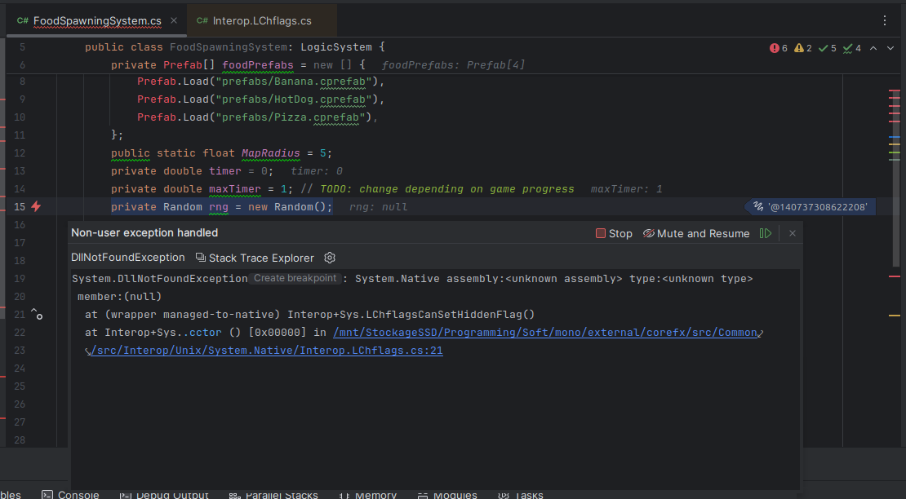
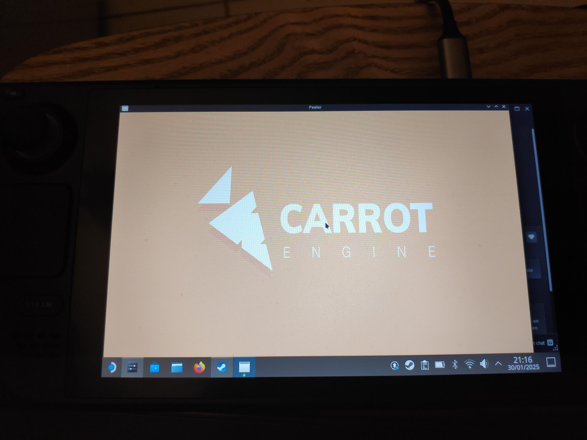
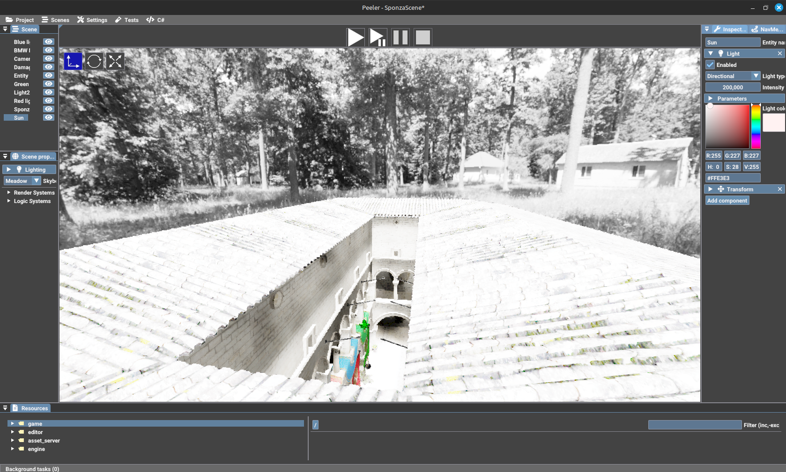
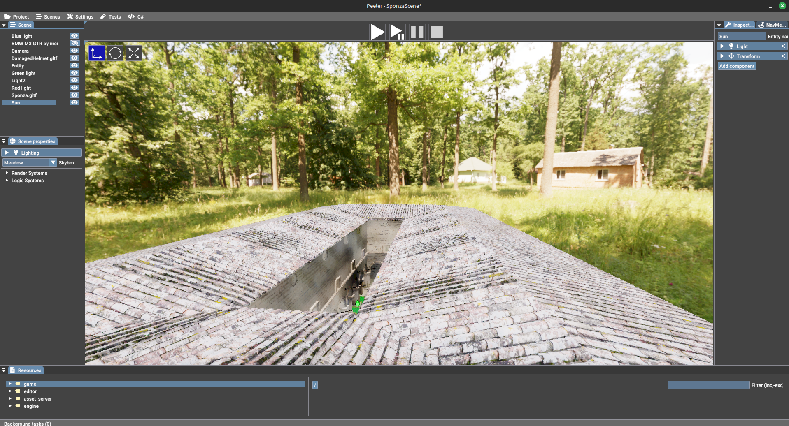
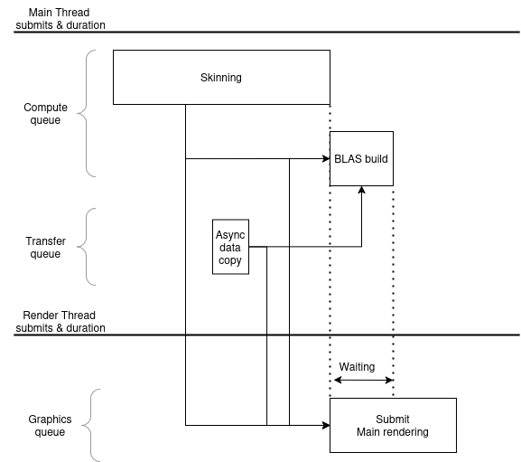
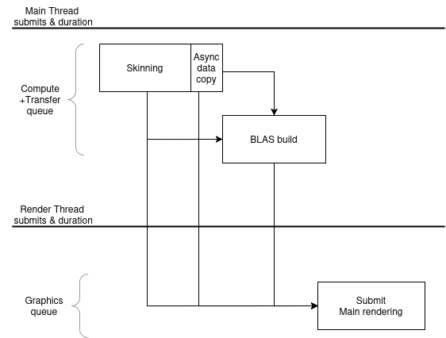

A few weeks ago, I decided to port my Windows-only engine to Linux, and also switch from an NVIDIA GPU to an AMD one. Here are a few interesting things I noted along the way.

# Why Linux?
&lt;CurrentYear&gt; is the year of the Linux desktop!

I am really not happy about the integration of AI and ads into Windows 11, therefore I do not want to switch to Windows 11. I also won't forgive Microsoft who revoked my lifetime key of Windows because I upgraded from Windows 7 to Windows 10, and then dared to change my computer parts.

Finally, I spend most of my time on my computer either programming, playing games, or procastinating on Reddit or Youtube: I don't have specific needs that prevent me from using Linux (thanks Proton!).
I also like the potential for customization.

# Why AMD?

Why not?
Also there tend to be easier to find than NVIDIA GPUs at launch.

# Preliminary work

## Cider

One of the dependencies of my engine is my own [fiber](https://en.wikipedia.org/wiki/Fiber_(computer_science)) library, called [Cider](https://github.com/jglrxavpok/cider).

Cider is a userland fiber library, which means it does not communicate with the OS to switch the execution context of a thread to implement its fibers.
However, this does not mean we can forget about the OS to switch between fibers.

The goal is to store the execution context when calling `yield` to remember the state in which the thread is, to be able to restore it later.
For this, you need to save some registers and the instruction pointer to be able to resume the execution.
While *technically*, you need to save only the registers your compiler saves between function calls, these registers are often chosen by the calling convention of this OS.
This means that MSVC and GCC (more precisely Windows and Linux) have different registers that need to be saved.

That's a lot of words to say that I needed some assembly specifically for Linux to save the correct registers.
If you want more information, take a look at the [Cider source code](https://github.com/jglrxavpok/Cider/). Its implementation is based on the [Fibers, Oh My!](https://graphitemaster.github.io/fibers) article if you want more information.

------

Another required change is related to exit codes: If a thread manages to go up the callstack of a fiber, I have added some code to immediately terminate the program, to avoid executing random instructions from memory.

However, I chose `-1` as the exit code, and on Linux the unit test which tested for this behavior failed.
The reason? The expected exit code was -1, but the received code was 255.

That's how I learned that despite the exit code being an int, Linux can only return a value between 0 and 255 for child processes, which broke the test.
The fix was simple, I chose 255 as the exit code.

This is a small example, but the unit tests of Cider helped me greatly to add Linux support and ensure everything worked.

## Safe Directory & Git

When switching to Linux, I kept my SSDs and reused the same files between Windows and Linux for programming.
However, git complained because the owner of the files did not match between Windows and Linux (how could they?)

Therefore, I had to add my project folder as a safe directory in git.

## Small differences between Windows and Linux

Of course, there were a few classical differences between the two OSes that created errors:
- Some files were referenced with the wrong case in my CMakeLists.txt, therefore Linux could not find them. This was easy, using the proper case was enough.
- Line endings: On Windows, CRLF is used, while Linux uses LF. GCC and most of my toolchain do not care for it. 

However, it seems `bash` does care about line endings! I cloned OpenXR-Hpp and VulkanHpp on a Windows machine, so their generation scripts were using CRLF, and launching them from the terminal created a rather weird error:
```
/usr/bin/env: «bash\r»: Aucun fichier ou dossier de ce nom
```
which in English means "No file with this name".

The script started with `#!/usr/bin/env bash`, however in CRLF, this is actually: `#!/usr/bin/env bash\r\n`.
Thanksfully my terminal was cooperative and showed the carriage-return character in the error!

`bash` obviously existed on my machine, but because of the line ending, my machine was looking for `bash\r`, which obviously is incorrect.

The fix was to re-checkout the generation scripts, to ensure the line ending was LF instead of CRLF.

## Interfacing with the OS

Obviously, I had to implement OS-specific interfaces for a few functions.
Most notably, I had to implement an interface for file handling* and a few helper functions for information about executables: my engine editor can call other executables, to compile shaders for instance.

\* The C++ standard library has abstractions for file I/O. However, I plan on supporting async file I/O at some point, and there is no support for this in the standard library as far as I know.

# Mono support
Mono was... hard to make work.
Installing Mono on Linux is rather simple, building from source is supposedly enough.

Everything worked fine, until I tested one demo game I was working on.

When the game switched from the lobby to the "main gameplay scene", my engine crashed, with the only information being:
- a callstack inside Mono code starting with `ves_icall_System_Reflection_MonoMethodInfo_get_parameter_info`
- an error message: 
```
mono_coop_cond_broadcast Cannot transition thread 0x7ffff5497d80 from STATE_BLOCKING with DO_BLOCKING
Signal: SIGABRT (Aborted)
```

After a few minutes looking up the error on the web and finding nothing, I decided to give Rider a shot.
I launched my game, attached Rider to the Mono runtime, switched the scene, and...

[](/assets/images/engine-linux-port/rider.png)
{: .centering-container }
Rider error popup showing that a DLL failed loading
{: .caption :}

Mono failed to load the `System.Native` DLL. I checked inside the DLLs bundled with my build of Mono, but there was no such DLL.

I learned that on Linux, Mono remaps some of the C# runtime DLLs to other dynamic libraries via the `/etc/mono/config` file.
To apply it, it is a [single line of code](https://github.com/mono/mono/issues/17593#issuecomment-547429077).

*However*, it still failed to load the DLL, just with a different path.

[](/assets/images/engine-linux-port/rider.png)
{: .centering-container }
Second Rider error popup showing that a DLL failed loading, this time showing a path for libmono-native.so
{: .caption :}

To help debug this issue, I used the `MONO_LOG_LEVEL=debug` environment variable to print everything Mono tried to do, and just before the crash I got this error:

```
Mono: DllImport attempting to load: '/home/jglrxavpok/sdks/mono-custom/lib/../lib/libmono-native.so'.
Mono: DllImport error loading library '/home/jglrxavpok/sdks/mono-custom/lib/../lib/libmono-native.so': undefined symbol: mono_add_internal_call_with_flags'.
```

After some objdump + grep, I found that this symbol is supposed to be in `libmonosgen-2.0.so`.
I expected it to be loaded by Mono directly, but apparently it is not.
I decided to just call `dlopen` to force to load this library directly on engine init, and this fixed my issues.

# Compilation differences
GLM supports swizzling for its vector types.

Like in GLSL, you can write:
```cpp
vec4 myVec;
vec2 uv = myVec.xy;
```

However, this compiles only under MSVC! GCC does not support the required extensions to use this exact syntax.
This meant I had to change all my code using swizzling to call the functional version instead:
```cpp
vec4 myVec;
vec2 uv = myVec.xy();
```

Nothing hard to do, but quite annoying that the default behaviour for GLM swizzling differs between the two compilers.

------

There were a lot of other tiny compilation issues, but nothing else major.

# AMD / NVIDIA
During the switch from Windows to Linux, I also changed my GPU from an NVIDIA RTX 3070 to an AMD 9070 XT.
There were a few surprises.

## SteamDeck
The port to Linux actually started a few months before this article, when I tried to run my engine on the SteamDeck, through Proton.

[](/assets/images/engine-linux-port/steamdeck.jpg)
{: .centering-container }
Carrot running on the SteamDeck
{: .caption :}

However, when trying to run my engine of the Deck, the engine would crash very quickly due to a "Descriptor pool out of memory" error.

When allocating descriptor sets in Vulkan, you need to reference a descriptor pool from which the sets will be allocated.
When creating this descriptor pool, you need to give a list of VkDescriptorPoolSize which describe the contents of the pool.
You also provide the maximum number of sets that the pool is able to generate.

For some reason, I thought this meant the descriptor pool sizes would describe the contents of the pool for a *single* descriptor set.
However, the sizes represent the resources available **for the entire pool**, which means that I always under-allocated resources for descriptor sets.
The AMD GPU present in the Deck was much less lenient than my NVIDIA 3070, which meant I encountered this error for the first time on the Deck. I don't remember seeing anything in the validation layers on my desktop, but I might have missed the error.

The fix was simply to multiply the set count to the resource count for each pool size, but it made me realise that the difference in manufacturer could complicate things.

## Skybox
After finally getting some image on screen, I noticed that my skyboxes had lost their color.

What is supposed to be a very green forest became very pale:

[](/assets/images/engine-linux-port/skybox.png)
{: .centering-container }
Sponza scene, with a skybox representing a forest. Due to a bug, the skybox is in grayscale
{: .caption :}


The skybox is drawn by my direct lighting pass, which then gets denoised with a custom-built à-trous denoiser.
However, because the à-trous algorithm is reused for my ambient occlusion denoising, I reused the code with different defines to handle the differences between the two passes.

Here's the specialisation for the ambient occlusion denoiser:
```glsl
#define PIXEL_TYPE float
#define PIXEL_SWIZZLE(v) (v).r
#define PIXEL_CONVERT_TO_VEC4(p) (p).rrrr

#include "denoise-base.compute.glsl"
```

And here's the specialisation for the direct lighting:
```glsl
#define PIXEL_TYPE vec4
#define PIXEL_SWIZZLE(v) (v)
#define PIXEL_CONVERT_TO_VEC4(p) (p)

#include "denoise-base.compute.glsl"
```

That way, `denoise-base` can have the following line of code and be reused between direct lighting and ambient occlusion:
`PIXEL_TYPE finalPixel = PIXEL_SWIZZLE(imageLoad(inputImage, coords));`


However, in the source code of `denoise-base` I referenced the input and output images of the denoiser as such:

```glsl
layout(r8, set = 1, binding = 0) uniform readonly image2D inputImage;
layout(r8, set = 1, binding = 1) uniform writeonly image2D outputImage;
```

Notice that the texture format is set to `r8` which means single-channel, 8 bits.
This is fine for ambient occlusion which deals with a grayscale image, but the direct lighting is an HDR RGB image!

For *some* reason, this worked fine on my NVIDIA GPU, but not AMD: the direct lighting result would be truncated to only use the contents of the red channel!
The fix was simple: I added a new parameter to select the texture format of the input and output images:

```diff
- layout(r8, set = 1, binding = 0) uniform readonly image2D inputImage;
+ layout(TEXTURE_FORMAT, set = 1, binding = 0) uniform readonly image2D inputImage;
- layout(r8, set = 1, binding = 1) uniform writeonly image2D outputImage;
+ layout(TEXTURE_FORMAT, set = 1, binding = 1) uniform writeonly image2D outputImage;
```

And `denoise-direct.compute.glsl` became:

```diff
+   #define TEXTURE_FORMAT rgba32f
    #define PIXEL_TYPE vec4
    #define PIXEL_SWIZZLE(v) (v)
    #define PIXEL_CONVERT_TO_VEC4(p) (p)

    #include "denoise-base.compute.glsl"
```

This fixed the issue:

[](/assets/images/engine-linux-port/skybox-fixed.png)
{: .centering-container }
Sponza scene, with a skybox representing a forest. This time, the forest is green, showing that the bug is fixed
{: .caption :}

## Synchronisation issues

The last issue I faced was related to synchronisation.

I noticed that my engine would freeze if I attempted to add skinned meshes to a scene, while raytracing was enabled.
Validation layers told me that a command buffer was waiting on a semaphore that had no way to be signaled.

My skinning computation is done on a compute queue, signals a semaphore (the "skinning semaphore"), and BLAS building waits on this semaphore before building the updated BLAS.
Furthermore, I also waited on this skinning semaphore before submit the "main" command buffer, which contain all the graphics work for the frame.

However, this is wrong: depending on your GPU and timings, you may not always have the same behaviour!
In my case, on my 3070 timings were such that the timeline was like this (representation not to scale, arrows represent waits):

[](/assets/images/engine-linux-port/nvidia-sync.png)
{: .centering-container }
Timeline 1, notice how different queues make the tasks overlap, meaning signaling the end of Skinning can trigger both "BLAS build" and "Main rendering" at once
{: .caption :}

While the skinning operation was going on, a transfer operation was queued, to prepare some data for the BLAS build.
This worked because my engine could get two separate queues for compute and transfer workloads on my 3070, and the transfer could finish before "BLAS build" needed the data, and before the main rendering was submitted.
However, I noticed something odd with my 9070XT: the queues were no longer separated!

Indeed, my engine would look for different queue families to get a compute and a graphic queue that are separated, but my AMD card reported this (via `vulkaninfo`):

```
VkQueueFamilyProperties:
========================
	queueProperties[0]:
	-------------------
		minImageTransferGranularity = (1,1,1)
		queueCount                  = 1
		queueFlags                  = QUEUE_GRAPHICS_BIT | QUEUE_COMPUTE_BIT | QUEUE_TRANSFER_BIT | QUEUE_SPARSE_BINDING_BIT
		timestampValidBits          = 64
		present support             = true

	queueProperties[1]:
	-------------------
		minImageTransferGranularity = (1,1,1)
		queueCount                  = 4
		queueFlags                  = QUEUE_COMPUTE_BIT | QUEUE_TRANSFER_BIT | QUEUE_SPARSE_BINDING_BIT
		timestampValidBits          = 64
		present support             = true

	queueProperties[2]:
	-------------------
		minImageTransferGranularity = (1,1,1)
		queueCount                  = 1
		queueFlags                  = QUEUE_SPARSE_BINDING_BIT
		timestampValidBits          = 64
		present support             = false
```

Notice how queue family 1 has multiple queues with both the COMPUTE and TRANSFER flags.

My engine chooses queues this way (I have yet to change this behavior):
1. Any queue that has the QUEUE_GRAPHICS_BIT flag set becomes the graphics queue.
2. Any queue that has the QUEUE_TRANSFER_BIT flag set and **does not** have the QUEUE_GRAPHICS_BIT flag set becomes the transfer queue.
3. Any queue that has the QUEUE_COMPUTE_BIT flag set and **does not** have the QUEUE_GRAPHICS_BIT flag set becomes the compute queue.
4. Completly ignore the fact that a queue family can have multiple queues and only use the first one in the family. (this is the thing I need to fix someday)
5. If no transfer queue is found, use the graphics queue.
6. If no compute queue is found, use the graphics queue.

With this logic, this meant that the compute queue would *also* be the transfer queue!
This means that all operations on compute and transfer queues were no longer concurrent, but strictly sequential.

[](/assets/images/engine-linux-port/amd-sync.png)
{: .centering-container }
Timeline 2, notice how using the same queue serializes all tasks, meaning signaling the end of Skinning can trigger only "BLAS build"
{: .caption :}

By the time the GPU attempts to execute "Main rendering", the "skinning semaphore" has already been signaled and consumed by "BLAS build", therefore it is no longer signaled. The GPU will wait forever for this semaphore to be signaled again.


The fix?
Because rendering already waited on the BLAS build, there was no point in waiting the "skinning semaphore" before starting rendering, if raytracing is enabled.
```diff
+ if (!hasRaytracedInstances) { // otherwise, the raytracing code will wait on the semaphore
	GetEngine().addWaitSemaphoreBeforeRendering(renderContext, vk::PipelineStageFlagBits::eVertexInput, *skinningSemaphores[modFrameIndex]);
+ }
```

# Conclusion
Porting my engine to Linux/AMD was not as hard as I thought it would be. However, at the same time, I encountered issues I could not have predicted.

Thanks to my hard work, I can now daily drive Linux and still work on my engine 😊


I hope this collection of anecdotes made you discover something, or was at least entertaining!