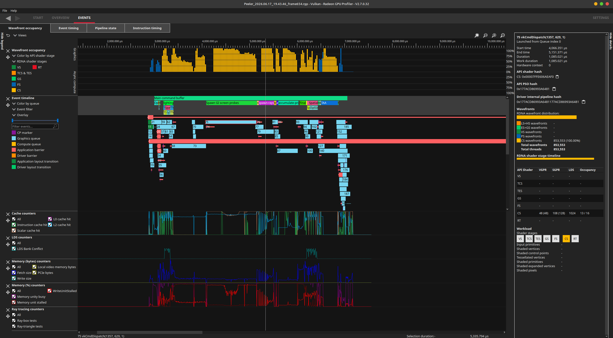
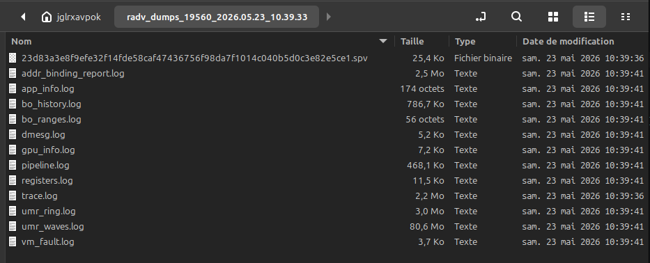
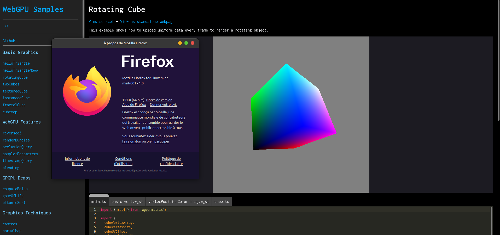

As written in my previous post, I switched to Linux and AMD GPUs for my main desktop PC last year.
Here's my experience with daily driving it.

Note: this is my experience with my setup, you may get a different experience based on what you do on your computer.

- [Distribution choice](#distribution-choice)
- [The usual suspects](#the-usual-suspects)
- [Programming](#programming)
    - [GPU Profiling](#gpu-profiling)
    - [GPU Debugging](#gpu-debugging)
    - [Hot reloading](#hot-reloading)
    - [WebGPU](#webgpu)
- [Gaming](#gaming)
- [Photo editing & art](#photo-editing--art)
- [Conclusion](#conclusion)

# Distribution choice
I selected Linux Mint for my desktop PC, because I liked the stability promise and its online community. 
The Linux Mint Forums always have my back when I get a weird error!

However, due to my hobby (engine dev), I often need up-to-date drivers, and their dependencies.
Thanksfully, in the specific case of Mesa, there is a way to get up-to-date drivers, by using a different package source:
[Tips for Troubleshooting Graphics Issues Rev. 1, Linux Mint Forums](https://forums.linuxmint.com/viewtopic.php?t=424779)

The alternative is to... build Mesa yourself and install one of its drivers.
This would sound insane to past-me using Windows, but if you are making Vulkan applications, it is a major advantage to have a local version of Mesa, which I will talk about further down this page.

# The usual suspects
Starting my daily driving journey, I knew audio issues were well known in Linux (but I was not sure how real this was). And of course, Microsoft hardware would probably not work well.

The rumors about audio issues on Linux are... partially true?
If I was not programming a game engine, I would never had any issue!

My engine uses OpenAL, which connects to the audio driver to play sounds. I don't know how it works under the hood, but if your program hits a breakpoint, the audio driver freezes ?!
It meant I could not hear my friends on Discord, nor my music, as soon as my engine hit a breakpoint or a crash.

Thanksfully, I found a cure! If you experience the same issue, add this to your environment variables: `ALSOFT_DRIVERS=pulse` to change the driver used by your application (change 'pulse' with another driver if you don't have pulse).

--------

I bought a Bluetooth dongle without checking for Linux support, and it worked out of the box! My audio headset can connect to it without issues and works fine for hours.

However, my Xbox Series gamepad randomly disconnects and reconnects when using it in Bluetooth. This is a problem when playing, as you can imagine!
I have not looked much deeper into it, because I'm used to wired gamepads, but I was still annoyed.

# Programming
## GPU Profiling
Mesa has support for Radeon GPU Profiler outputs, but Radeon GPU Profiler does not map instructions to the original source code, making it complicated to figure out which part of your code is taking too long.
However, [RGP has very recently added source code support for DirectX](https://gpuopen.com/learn/radeon-developer-tool-suite-shader-source-code/), so this might appear soon for Vulkan (at least I hope!).

{: .centering-container }
Radeon GPU Profiler, showing the different event markers, with the occupancy of the GPU, and various counters showing the performance of the GPU
{: .caption :}

NSight Graphics (NVIDIA's equivalent) is able to show hotspots in your GLSL/HLSL/Slang source directly, which lowers the time to figure out your performance bottlenecks.

However, Mesa + RGP have the benefit to just work (tm) without needing to install "anything" (apart from Mesa).

## GPU Debugging
I used NVIDIA Aftermath on Windows to get information when my engine crashed or hung the GPU, and there is an alternative with Mesa and RADV (its Vulkan driver for AMD):
Use the following environment variable: `RADV_DEBUG=hang,nocache`

When the application crashes with the environment variable active, RADV will generate a list of files to help you debug:

{: .centering-container }
List of files generated by RADV when your application crashes
{: .caption :}

For a description of each of the files, I refer you to [Debugging GPU hangs with RADV](https://docs.mesa3d.org/drivers/amd/hang-debugging.html) which explains everything you need to debug with RADV.

Debugging crashes with RADV was not as ""easy"" than with NSight Graphics. Was it because I was used to NSight Graphics? Was it because I was used to use a UI for understanding the crash?
I do not know.

However, what I do know is that I could reduce the friction myself (queue "Thanos Fine I'll do it myself" gif).

- Driver crashes? Because I built it myself, I could figure out where and why. Good luck doing this on Windows with NVIDIA drivers!
- Dump generation takes too long? [I could optimise it](https://gitlab.freedesktop.org/mesa/mesa/-/merge_requests/36451).
- Dump shows assembly where waves are stopped, but no source code is displayed? [I could add it](https://gitlab.freedesktop.org/mesa/mesa/-/merge_requests/36443).
- Address binding reports do not contain the names of the objects, making it hard to understand what resource has been used-after-free? [I could include them](https://gitlab.freedesktop.org/mesa/mesa/-/merge_requests/41875).

Okay this might be a bit too arrogant.
I'm happy that I could improve the tools I use for my engine.

----------

Unsurprisingly, having source access to the driver helps understand what it does!
I have also been able to understand a crash I had in my engine:
1. Create a VkImage
2. Write it inside a descriptor buffer
3. Destroy VkImage
4. Use descriptor buffer
5. Kaboom

When binding an image or buffer, my engine checks if it was not already bound, using the VkImage value (which is basically a pointer for RADV) for the equality check. However, in rare circumstances, the VkImage can reuse the same memory range as a previously-bound image, failing the equality check. Which meant that the descriptor buffer did not point to the memory of the new image but instead of the old one. ([Relevant commit](https://codeberg.org/jglrxavpok/Carrot/commit/43c80fdd473f011180736a00b75391ae76d5c446#diff-36d0d0cc7c2872b590a9f141137b79a2cde0abe5))

## Hot reloading
I've discovered [Live++](https://liveplusplus.tech/) at work a few years ago, and it's amazing!
So I started using it at home too with my own license when I was on Windows.
However, Live++ is not available on Linux *[yet](https://mastodon.gamedev.place/@molecularmusing/116421017974828688)* so I looked for a replacement.
I found [jetlive](https://github.com/ddovod/jet-live) to be enough for my usecase, and it's open source so [you can modify it for your needs](https://github.com/ddovod/jet-live/pull/39) 😊

## WebGPU
WebGPU was announced to ship in Firefox with version 141 ! But Linux support for stable versions would come in 2026.
However, at some point during the year, the version available on the Linux Mint repositories got WebGPU support with no fanfare, but it's here!

{: .centering-container }
WebGPU sample running on Firefox 151 on Linux Mint
{: .caption :}

Now I can take a look at porting my engine for the web 👀

# Gaming
It is no news that gaming on Linux has come a long way, in no small part thanks to Wine and Proton. In the past year, I almost had no issues to play games in my Steam library.
I played new releases like Silksong, Clair Obscur, or DOOM: The Dark Ages. I played recent-ish games like Helldivers II, Ultrakill, or Factorio.
Most of it without issues.

However, it would be lying to say that I had *no* issues.
- Helldivers II had a crash only on Linux in a recent update. Thanksfully, there was a quick fix inside Proton and then the game itself.
- Installing and updating PEAK mods manually was not complicated, but slightly delayed sessions with friends.
- VR did not work when I tried to play with my Valve Index a year ago, no reason why. However, it now works flawlessly! I think the new Mesa versions helped a lot.
- Pico Park did not work for some reason (did not look into it)
- Keeper crashes at a specific spot. Apparently [there is a fix for it](https://steamcommunity.com/app/3043580/discussions/0/599667160179399536/) but I have not tested it yet.
- Logging into the Minecraft launcher would not work my login+password, which is apparently a known issue on Linux. Thanks Microsoft.

# Photo editing & art
I am by no means a graphical artist, I barely frame pictures correctly. However, either for memes or sending screenshots, I still regularly use an image editor.

On Windows, I was used to Paint.NET: easy to use, worked fine for my skill level.
In the last year, I've found that Krita worked well for me as a replacement. However, it is closer to a Photoshop replacement than a Paint one, so this means understanding brushes, and a slightly more complex UI.
For cropping images, adding text, circling stuff, the difficulty curve was not too steep !

# Conclusion

I will stay with Linux on my main PC for the foreseeable future!
If you are like me, and spend most of your time programming, browsing the web and playing games, you should give Linux a try 😉